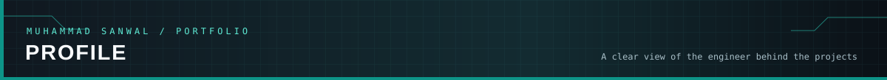
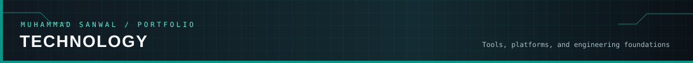
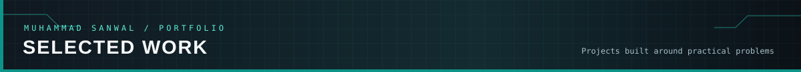
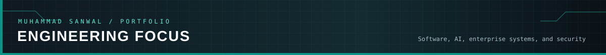
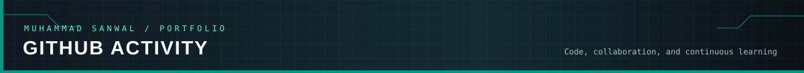
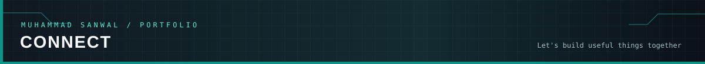

<div align="center">




<br/>

<a href="https://github.com/sanwal7887535-bot?tab=repositories"></a>
<a href="https://www.linkedin.com/in/muhammad-sanwal-4420a02b9/"></a>


</div>

---



## Software Developer | IT Student

I am **Muhammad Sanwal**, a Bachelor of Science in Information Technology student at the University of the Punjab, Lahore, Pakistan.

I am interested in building useful software, integrating AI into practical workflows, and developing secure enterprise systems. My work and learning span full-stack development, backend systems, databases, Odoo, and security monitoring.

<table>
<tr>
<td width="50%" valign="top">

### Engineering interests

- Software and full-stack development
- AI-powered applications and workflow automation
- Odoo and enterprise resource planning
- ERP security monitoring and compliance
- Database design and management
- API integration and system design

</td>
<td width="50%" valign="top">

### Working principles

- Understand the problem before choosing tools.
- Prefer maintainable and testable implementations.
- Treat security as part of system design.
- Use automation to remove repetitive work.
- Learn by building, testing, and improving.

</td>
</tr>
</table>

---



<div align="center">

### Programming languages

<a href="https://isocpp.org/"></a>&nbsp;&nbsp;
<a href="https://www.oracle.com/java/"></a>&nbsp;&nbsp;
<a href="https://www.python.org/"></a>&nbsp;&nbsp;
<a href="https://developer.mozilla.org/en-US/docs/Web/JavaScript"></a>

### Web development

<a href="https://html.spec.whatwg.org/"></a>&nbsp;&nbsp;
<a href="https://www.w3.org/Style/CSS/"></a>&nbsp;&nbsp;
<a href="https://react.dev/"></a>&nbsp;&nbsp;
<a href="https://vite.dev/"></a>&nbsp;&nbsp;
<a href="https://nodejs.org/"></a>&nbsp;&nbsp;
<a href="https://tailwindcss.com/"></a>

### Databases and tools

<a href="https://www.mysql.com/"></a>&nbsp;&nbsp;
<a href="https://www.postgresql.org/"></a>&nbsp;&nbsp;
<a href="https://git-scm.com/"></a>&nbsp;&nbsp;
<a href="https://github.com/"></a>&nbsp;&nbsp;
<a href="https://code.visualstudio.com/"></a>&nbsp;&nbsp;
<a href="https://www.docker.com/"></a>&nbsp;&nbsp;
<a href="https://ubuntu.com/"></a>

### Enterprise and security

<a href="https://www.odoo.com/"></a>&nbsp;&nbsp;&nbsp;
<a href="https://wazuh.com/"></a>

</div>

<sub>Icons link to official technology websites. This list describes my toolkit and areas of study, not equal proficiency in every technology.</sub>

---



<table>
<tr>
<td width="50%" valign="top">

### AEGISERP

**Automated Security Visibility & Compliance Assurance**

A security-focused project targeting Odoo Enterprise and Wazuh integration, designed to improve ERP security visibility and compliance evidence.

**Development scope**

- Odoo login event monitoring
- Structured security event collection
- Sensor-to-monitoring integration
- Wazuh decoders and detection rules
- Security hardening and compliance evidence

**Technology direction**

`Odoo Enterprise` `Python` `Wazuh` `Linux` `Docker`

<a href="https://github.com/sanwal7887535-bot?tab=repositories"></a>

<sub>FYP development project. The list describes current development goals, not a claim that every feature is complete.</sub>

</td>
<td width="50%" valign="top">

### FAURI MADAD

**Voice-First Emergency First-Aid Assistant**

An AI-powered web application that provides structured first-aid guidance through voice and text, with English and Urdu support.

**Features**

- Voice and text interaction
- AI-generated emergency guidance
- Step-by-step first-aid instructions
- Safety warnings and actions to avoid
- Rescue 1122 guidance
- Text-to-speech support

**Technology stack**

`React` `Vite` `Tailwind CSS` `Gemini API` `Express` `Web Speech API` `Vercel`

<a href="https://github.com/sanwal7887535-bot/fauri-madad-ai-emergency-assistant"></a>

</td>
</tr>
</table>

---



<table>
<tr>
<td width="25%" valign="top">

### Software

- Full-stack development
- Backend systems
- REST APIs
- Object-oriented programming
- Data structures and algorithms

</td>
<td width="25%" valign="top">

### AI and automation

- LLM-powered applications
- AI API integration
- Intelligent assistants
- Workflow automation
- Practical AI solutions

</td>
<td width="25%" valign="top">

### Enterprise

- Odoo development
- ERP workflows
- Module customization
- Business process automation
- System integration

</td>
<td width="25%" valign="top">

### Security

- Security event monitoring
- Detection and alerting
- Compliance evidence
- Application hardening
- Security architecture

</td>
</tr>
</table>

### Current engineering direction

```text
ODOO ENTERPRISE
      |
      | Security events
      v
AEGISERP SENSOR
      |
      | Structured events
      v
WAZUH MONITORING
      |
      +-------------------+
      |                   |
      v                   v
DETECTION             ALERTING
      |                   |
      +---------+---------+
                |
                v
     SECURITY VISIBILITY
       AND EVIDENCE
```

---



<div align="center">


<br/><br/>


</div>

---

### Contribution activity

<div align="center">


</div>

---

## Education and achievements

<table>
<tr>
<td width="60%" valign="top">

### Bachelor of Science in Information Technology

**University of the Punjab**  
Lahore, Pakistan

`2023 — Present`

Academic interests include software engineering, database systems, data structures, algorithms, web development, and artificial intelligence.

</td>
<td width="40%" valign="top">

### Academic highlights

**District-level recognition**  
First position in matriculation at district level.

**Scholarship**  
Fully funded scholarship at Akhuwat Institute.

**Practical development**  
Software development, AI application, and enterprise security project work.

</td>
</tr>
</table>

---



<div align="center">

I am interested in software development, AI automation, enterprise applications, and opportunities to learn through meaningful engineering work.

<br/>

<a href="https://github.com/sanwal7887535-bot"></a>
<a href="https://www.linkedin.com/in/muhammad-sanwal-4420a02b9/"></a>

<br/><br/>



</div>
